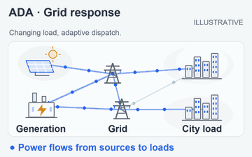
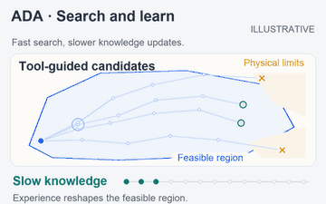
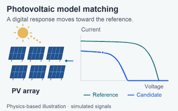
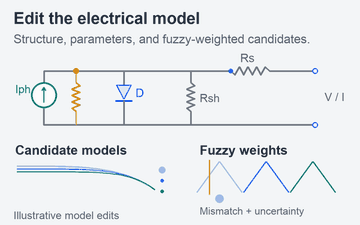
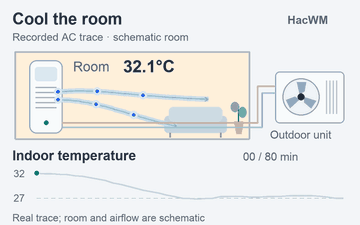
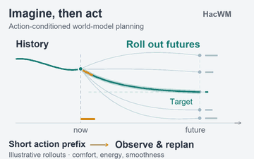

# Chris · Mengqi Han

# 

**Building agents and world models for physical systems.**  
Ph.D. student at **Shanghai Jiao Tong University**.

I work on agents that turn intent into validated actions,  
and world models that connect observations, prediction, and control.

[Research](#research)  ·  [Engineering](#engineering-foundations)  ·  [Code](#earlier-work)  ·  [Email](mailto:a25505597703@gmail.com)

## Research

Three projects on **reliable agentic decision-making** and **transferable world models** for physical systems. Each pair shows the system on the left and the method's mechanics on the right. Click either panel for the full-size animation.

### 01 · ADA — Agile Dispatch Agent

**Problem.** When an end-to-end dispatch agent fails, was the problem formulated incorrectly, was the solver unsuitable, or was the feedback misleading? ADA addresses this **failure-attribution ambiguity** as grid conditions and constraints change.

**Core method.**

- **Observe and formulate:** an MCTS Planner actively queries tools to augment the grid state and construct objectives and constraints; problem–algorithm alignment selects an appropriate solver.
- **Learn at two speeds:** fast action knowledge adapts tool-selection priors, while slower task knowledge rebuilds objectives, constraints, and solver preferences from accumulated trajectories.
- **Separate execution from reflection:** a synchronous physical-feasibility gate controls action admission; semantic judging and knowledge updates run asynchronously.

**Validation.** Four L2RPN simulation settings cover ambiguous redispatch, renewable uncertainty, extreme disturbances, and storage coordination. Ablations compare knowledge-update schedules; the theory characterizes local knowledge tracking under explicit stability assumptions.

| Grid response | Tool search & knowledge adaptation |
| :---: | :---: |
|  |  |

*Visualizations: schematic grid behavior and search mechanics, not an L2RPN experiment replay.*

---

### 02 · SOA — Bilevel Simulation Refinement

**Problem.** Electrical simulators can diverge from real systems when **circuit structure and component parameters change together**, especially with incomplete measurements. Fitting parameters within a fixed topology cannot resolve every mismatch.

**Core method.** SOA couples two optimization levels: correcting the simulator and learning to propose better corrections.

- **Upper level — improve the simulation model:** a domain-initialized LLM proposes structural and parametric candidates. A Takagi–Sugeno fuzzy system adjusts the weights on simulation error and modeling entropy in the ranking objective; elite models enter a monotonic-stack experience buffer.
- **Lower level — improve the proposal policy:** PPO learns from buffered models using output-format, reasoning-process, and physical-mechanism rewards, including circuit-law residuals.

**Validation.** Evaluation combines measured photovoltaic I–V–P data, PV structural-mismatch simulations, and Ngspice analog-circuit benchmarks. Ablations examine fuzzy selection, experience retention, and reward design.

| Photovoltaic response matching | Model candidates & fuzzy ranking |
| :---: | :---: |
|  |  |

*Visualizations: physics-based PV illustrations, not recorded SOA optimization results.*

---

### 03 · HacWM — Cross-Model Air-Conditioner Control

**Problem.** Different actuator characteristics and thermal delays make air-conditioning controllers difficult to transfer across devices, while online planning must work within a limited compute budget.

**Core method.** HacWM combines a transferable predictor with **physics-guided, low-dimensional trajectory sampling**.

- **Shared dynamics:** JEPA-style multi-step latent prediction uses device-balanced batches and nested random projections across latent and device axes to regularize cross-device representations.
- **Physical outputs:** a physics-guided decoder combines actuator-response priors with learned corrections to predict temperature, cooling, and electricity use.
- **Coordinated planning:** sample coupled compressor, expansion-valve, and fan trajectories; rank rollouts by efficiency, temperature regulation, and action continuity. Execute a short action prefix, observe, and replan, with learned parameters frozen across devices.

**Validation.** Closed-loop evaluation spans two simulators and a held-out real air conditioner under multiple operating conditions. Open-loop prediction and fixed-budget planning are evaluated separately.

| Air-conditioning system & recorded trace | Coordinated rollouts & replanning |
| :---: | :---: |
|  |  |

*Visualizations: the left panel includes a recorded AC run of unspecified model version; the room, airflow, and right-hand rollouts are schematic. The trace is separate from the paper's evaluation evidence.*

## Engineering Foundations

- **Agent orchestration & validation** — Connect intent, tools, solvers, and feedback into verifiable workflows. *ADA · SOA*
- **Prediction & control** — Connect device observations, learned dynamics, and planning to control actions. *HacWM*
- **Cloud–edge systems** — Connect microservice orchestration with an edge-computing testbed for flexible production. *ECPAD*

## Earlier Work

| Project | Work | Explore |
| :--- | :--- | :--- |
| **ECPAD** | Edge-computing architecture and microservice orchestration for a flexible production line, with a self-built experimental platform. | [Code](https://github.com/kongfuguagua/ECPAD) · [Paper](https://ieeexplore.ieee.org/document/10774337) |
| **DANN** | Transfer learning for motor-imagery EEG classification; my undergraduate thesis project at Harbin Institute of Technology. | [Code](https://github.com/kongfuguagua/DANN_EEG) · [Paper](https://ieeexplore.ieee.org/document/10241474/) |

## Contact

Let's talk about agentic systems, world models, and AI engineering for physical systems.

[Email](mailto:a25505597703@gmail.com)  ·  [GitHub](https://github.com/kongfuguagua)
