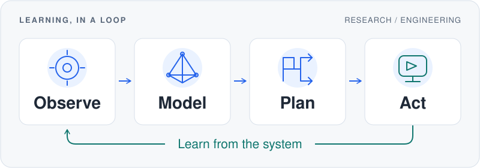
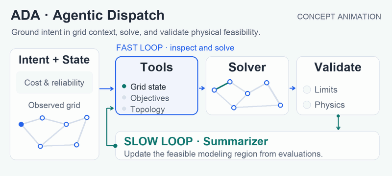
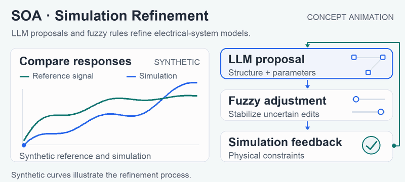
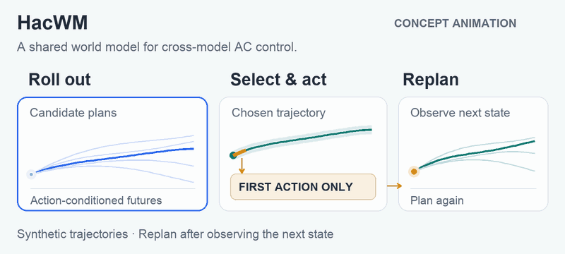
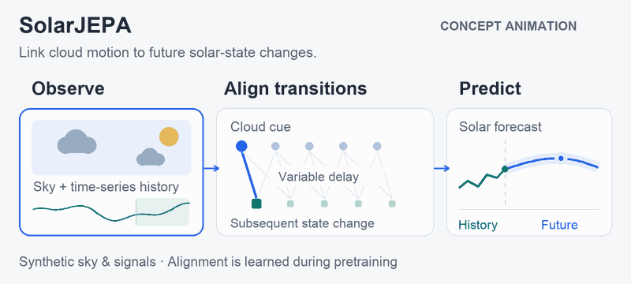

# Chris · Mengqi Han

**Building agents and world models for real-world systems.**

Ph.D. student at **Shanghai Jiao Tong University**. I work on agents that turn intent into validated actions, and world models that connect observations, prediction, and control.

[Email](mailto:a25505597703@gmail.com) · [Research](#research) · [Engineering](#engineering-foundations) · [Code](#earlier-work)

## Research

Two connected directions: **agents that reason and act**, and **world models that predict and guide control**. The animations below illustrate the methods; all depicted signals and states are synthetic.

### Agentic Systems

#### ADA · Agentic Dispatch

Turn power-system dispatch intent into mathematical models, tool-assisted solving, and physically validated actions. Feedback connects fast decision adaptation with slower updates to modeling knowledge.

#### SOA · Simulation Refinement

Bring electrical-system simulations closer to measured behavior through iterative structural and parameter refinement. LLM proposals, fuzzy-rule guidance, and simulation feedback connect reasoning with physically grounded updates.

### World Models

#### HacWM · World Models for Control

Learn action-conditioned device dynamics to support control across different air-conditioner models. World-model rollouts and receding-horizon planning connect predictions to energy-aware control actions.

<!-- #### SolarJEPA · Multimodal Forecasting

Learn from sky imagery and time-series observations with multimodal self-supervision. Transition alignment links cloud dynamics to subsequent solar-energy changes for forecasting. -->

## Engineering Foundations

- **Agent orchestration & validation** — Connect intent, tools, solvers, and feedback into verifiable workflows. *ADA · SOA*
- **Prediction & control** — Connect multimodal observations, learned dynamics, and planning to decisions. *SolarJEPA · HacWM*
- **Cloud–edge systems** — Connect microservice orchestration with an edge-computing testbed for flexible production. *ECPAD*

## Earlier Work

**ECPAD** — Edge-computing architecture and microservice orchestration for a flexible production line, with a self-built experimental platform.

[Code](https://github.com/kongfuguagua/ECPAD) · [Paper](https://ieeexplore.ieee.org/document/10774337)

**DANN** — Transfer learning for motor-imagery EEG classification; my undergraduate thesis project at Harbin Institute of Technology.

[Code](https://github.com/kongfuguagua/DANN_EEG) · [Paper](https://ieeexplore.ieee.org/document/10241474/)

## Contact

Let's talk about agentic systems, world models, and AI engineering for physical systems.

[a25505597703@gmail.com](mailto:a25505597703@gmail.com) · [GitHub](https://github.com/kongfuguagua)
